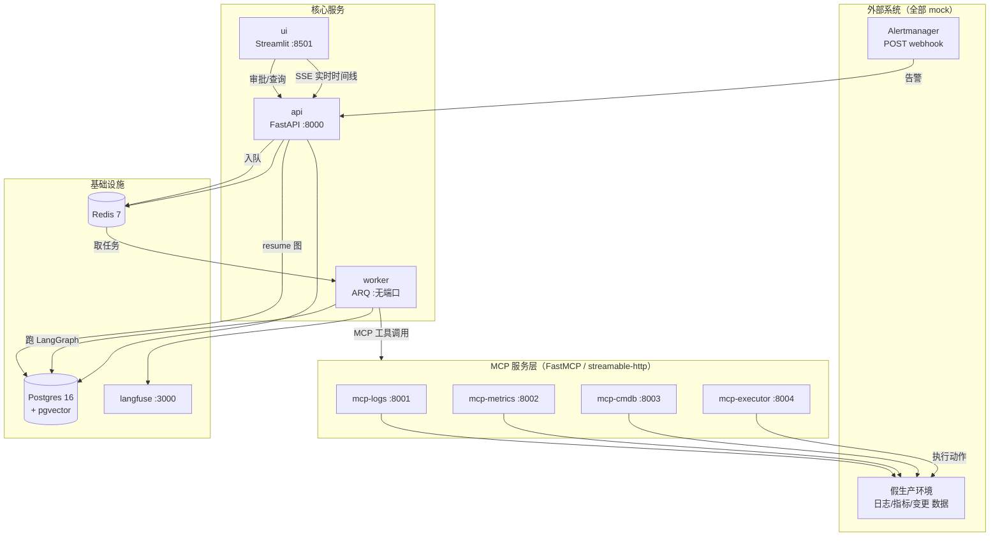
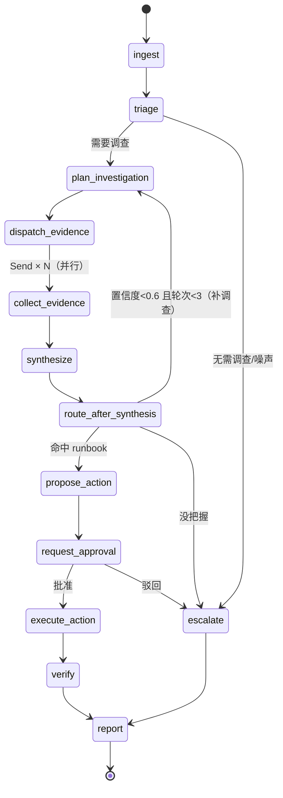
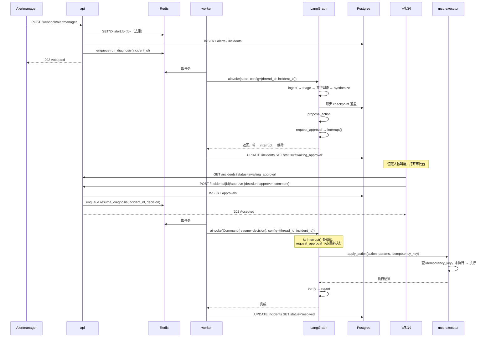

# 01 · 架构设计

> 项目代号：`oncall-copilot`（智能值班 Copilot）
> 本文回答三件事：**系统由哪些服务组成**、**Agent 怎么跑**、**为什么这么设计**。

---

## 1. 项目一句话

接收 Prometheus Alertmanager 告警 → 自动并行调查多系统证据（日志 / 指标 / 变更 / 历史故障）→ 产出带置信度的根因判断与处置方案 → 高危操作走**人在环审批**后经 MCP 执行 → 全程可观测、可评估、可断点续跑。

**面试叙事**（简历上的写法）：

> 基于 MCP + LangGraph 的故障诊断 Agent：多系统工具编排 + 人在环审批 + 全链路可观测

**不要写成**："运维告警分析平台"（听起来像内部工具，技术权重被业务盖住）。

---

## 2. 服务拓扑



### 端口分配

compose 一共 **11 个服务**（下表按占用内存从大到小也差不多是这个顺序，见「分层启动」）：

| 服务 | 端口 | 说明 | 什么时候起 |
|---|---|---|---|
| `api` | 8000 | 告警 webhook、查询、审批、SSE | W3 起 |
| `mcp-logs` | 8001 | 日志检索 MCP server | W2 起 |
| `mcp-metrics` | 8002 | 指标查询 MCP server | W2 起 |
| `mcp-cmdb` | 8003 | 拓扑/变更 MCP server | W2 起 |
| `mcp-executor` | 8004 | 处置执行 MCP server（危险） | W2 起 |
| `worker` | — | ARQ 消费者，不暴露端口 | W8 起 |
| `ui` | 8501 | Streamlit 审批台 | W7 起 |
| `postgres` | 5432 | 业务表 + 向量 + checkpointer | **W1** |
| `redis` | 6379 | 去重 / 锁 / 队列 | **W1** |
| `langfuse` | 3000 | 追踪面板（**单个就吃 1GB+，W10 之前不要起**） | W10 起 |
| `alertgen` | — | 定时灌假告警，无端口 | W2 起 |

> ⚠️ **11 个容器一起跑大约要 3~4 GB 内存**，一台 16GB 的笔记本同时开着浏览器和 IDE 会非常吃力，容器可能被 OOM 杀掉。
> compose 里已经用 `profiles` 分好层：`postgres` / `redis` 不带 profile，**`docker compose up -d` 默认只起这两个**。按上表的"什么时候起"逐周加 `--profile mcp` / `--profile app` / `--profile obs`。分层表和完整命令见 [03-代码指导-基础层.md](03-代码指导-基础层.md) §2 的「分层启动」。

### 为什么把「工具」拆成独立进程（而不是普通函数）

这是整个项目最核心的架构决策，也是面试必被追问的点。四条理由，每条都能落到代码上：

| 理由 | 具体体现 |
|---|---|
| **权限隔离** | `mcp-executor` 是唯一持有"写权限"的服务；诊断 Agent 只能调只读的三个 server。进程级隔离比函数级 if 判断可信。 |
| **独立部署与扩缩** | 日志 server 是 IO 密集、指标 server 要连时序库，两者资源画像不同，可以分开扩容。 |
| **跨团队边界** | 现实中日志系统归 SRE 团队、CMDB 归平台团队。MCP 是"跨团队的工具契约"，函数调用做不到这个语义。 |
| **可替换** | mock 换成真的 Loki / Prometheus / 真 CMDB，只改 server 内部实现，Agent 一行不动。**这正是"半真实数据"方案的立论基础。** |

> 反面教材：如果你的工具就是自家后端的一个方法，上 MCP 是硬凑。这个项目之所以选得对，是因为工具**天然属于不同系统**。

---

## 3. MCP 工具清单

工具设计原则：**返回结构化、可被 LLM 判断的摘要，不返回原始大文本**。日志别塞 500 行给模型，塞"错误率 + Top 3 异常模式 + 时间窗"。

### 3.1 `mcp-logs` :8001

| 工具 | 入参 | 出参 | 说明 |
|---|---|---|---|
| `search_logs` | `service, pattern, minutes=30, level=None, limit=100` | `list[LogLine]` | 按模式检索，返回已截断行 |
| `error_rate` | `service, minutes=30` | `{total, errors, rate, by_level}` | 只读聚合，避免拉全量 |
| `get_trace` | `trace_id` | `list[LogLine]` | 按 trace 串起一次请求 |
| `top_error_patterns` | `service, minutes=30, top=5` | `list[{pattern, count, sample}]` | 日志模板聚类（可先用正则粗聚） |

### 3.2 `mcp-metrics` :8002

| 工具 | 入参 | 出参 |
|---|---|---|
| `query_range` | `service, metric, minutes=60, step=60` | `list[{ts, value}]` |
| `detect_anomaly` | `service, metric, minutes=60` | `{metric, anomalous, z_score, window, baseline, peak}` |
| `compare_to_baseline` | `service, metric, hours=24` | `{current, baseline, delta_pct}` |

### 3.3 `mcp-cmdb` :8003

| 工具 | 入参 | 出参 |
|---|---|---|
| `get_topology` | `service` | `{service, upstream, downstream, replicas}` |
| `list_changes` | `service, hours=24` | `list[{id, type, operator, at, detail, commit}]` |
| `get_owner` | `service` | `{team, oncall, channel}` |

### 3.4 `mcp-executor` :8004 —— 危险工具，全部带 `dry_run`

| 工具 | 说明 | 风险等级 |
|---|---|---|
| `get_action_catalog` | 白名单动作清单 + 风险等级 + 是否需要审批 | 只读 |
| `dry_run_action` | 预演，返回"将要做什么" | 只读 |
| `apply_action` | **真正执行**，必须带 `idempotency_key` | HIGH / CRITICAL |
| `get_action_status` | 按 key 查执行状态 | 只读 |
| `rollback` | 回滚 | HIGH |

**硬约束（写进 server，不靠 prompt 约束）**：
1. 动作必须在 `ACTION_CATALOG` 白名单里，否则直接抛错。
2. `apply_action` 第一件事是查 `idempotency_key` 是否已执行过 —— 已执行则**原样返回首次结果**，不重复执行。
3. `CRITICAL` 级动作额外要求 `approval_id` 参数非空，否则拒绝。

---

## 4. LangGraph 图设计

### 4.1 State 定义

```python
# app/agent/state.py
import operator
from typing import Annotated, TypedDict, Literal


class Usage(TypedDict):
    prompt_tokens: int
    completion_tokens: int
    llm_calls: int


def merge_usage(left: Usage, right: Usage) -> Usage:
    """并行分支的 token 统计要合并，不能覆盖。"""
    return Usage(
        prompt_tokens=left["prompt_tokens"] + right["prompt_tokens"],
        completion_tokens=left["completion_tokens"] + right["completion_tokens"],
        llm_calls=left["llm_calls"] + right["llm_calls"],
    )


class IncidentState(TypedDict, total=False):
    # ---- 输入 ----
    incident_id: str
    alert: dict                      # 归一化后的告警

    # ---- 调查过程 ----
    evidence_requests: list[dict]     # 本轮要查什么（由 LLM 决定）
    evidence: Annotated[list[dict], operator.add]   # 累积证据，并行分支靠它合并
    investigation_round: int
    missing_info: list[str]           # 上一轮缺什么（回环时喂给 LLM）

    # ---- 结论 ----
    hypotheses: list[dict]            # 排序后的根因假设
    confidence: float

    # ---- 处置 ----
    plan: dict | None                 # 处置方案
    approval: dict | None             # 审批决定
    execution: dict | None            # 执行结果
    verification: dict | None         # 执行后验证

    # ---- 元信息 ----
    status: str
    usage: Annotated[Usage, merge_usage]
    errors: Annotated[list[str], operator.add]
```

**两个 reducer 是刻意的**，面试会问：

- `evidence` 用 `operator.add`：并行 fan-out 出 N 个分支，每个分支返回一条证据，默认行为是**后写覆盖**，必须用 reducer 做列表拼接。
- `usage` 用自己的 `merge_usage`：token 是**数字求和**，不是列表拼接，所以要自定义 reducer。
- `errors` 用 `operator.add`：错误只追加，不覆盖。

### 4.2 节点清单

| # | 节点 | 类型 | 职责 | 用到的技术 |
|---|---|---|---|---|
| 1 | `ingest` | 普通 | 归一化告警、指纹去重、建/复用 incident | Redis `SET NX` |
| 2 | `triage` | 普通 | 严重度判定；明显无需调查的直接转人工 | LLM 结构化输出 |
| 3 | `plan_investigation` | 普通 | 决定本轮查哪些证据（返回 `EvidenceRequest[]`） | LLM 结构化输出 |
| 4 | `dispatch_evidence` | 条件边 | 把 N 个请求变成 N 个 `Send` 并行分支 | `Send` API |
| 5 | `collect_evidence` | 普通（并行实例） | 调对应 MCP 工具、写 evidence 表 | MCP Client |
| 6 | `synthesize` | 普通 | 汇总证据 → 根因假设 + 置信度 | 结构化输出 + pgvector 检索历史故障 |
| 7 | `route_after_synthesis` | 条件边 | 置信度低→回环；命中 runbook→处置；否则转人工 | 条件路由 |
| 8 | `propose_action` | 普通 | 生成处置方案 + 风险分级 | LLM + runbook 表 |
| 9 | `request_approval` | **中断点** | `interrupt()` 暂停，等人审批 | HITL |
| 10 | `route_after_approval` | 条件边 | 批准→执行；驳回→转人工 | HITL |
| 11 | `execute_action` | 普通 | 幂等执行（MCP executor + Redis 锁） | 幂等 + 分布式锁 |
| 12 | `verify` | 普通 | 执行后重新拉指标确认恢复 | MCP |
| 13 | `escalate` | 普通 | 转人工，写原因 | — |
| 14 | `report` | 普通 | 落库、生成报告、写知识库 | pgvector 写入 |

### 4.3 图结构



### 4.4 关键设计决策（每条都对应一个面试题）

| 决策 | 为什么 | 面试怎么讲 |
|---|---|---|
| **用 `Send` 并行采集证据，不用串行** | 查日志 2s + 查指标 2s + 查变更 1s，串行 5s，并行 2s。诊断是延迟敏感场景。 | "我把证据采集设计成 fan-out/fan-in：dispatch 节点返回 Send 列表，LangGraph 起 N 个并行分支，靠 `operator.add` reducer 合并。实测端到端从 X 秒降到 Y 秒。" |
| **`synthesize` 输出结构化假设 + 置信度，而不是一段话** | 置信度是**路由依据**：低于阈值回环补调查，高于阈值才敢提处置方案。自由文本没法做判断。 | "根因判断必须是可编程的中间结果，不能是自然语言。" |
| **调查回路有轮次上限（3 轮）** | 没有上限就是无限循环 + 无限 token 消耗。 | "Agent 的每个循环都要有出口，这是成本控制问题。" |
| **审批用 `interrupt()`，不用"执行前弹个确认"** | 必须能被叫走 2 小时后回来继续，图状态要落盘。 | 见 §5。 |
| **执行必须幂等** | 网络超时后重试是常态，重复重启 = 二次故障。 | "幂等键 = plan_id + action + params 的哈希，executor 侧查表短路。" |
| **`verify` 独立成节点** | "执行成功了" ≠ "故障恢复了"。 | "我区分了 action success 和 incident resolved，前者是 API 返回码，后者要指标回落。" |

---

## 5. 人在环审批（HITL）时序

这是项目最有含金量的部分，完整走一遍：



### 三个必须踩过的坑（踩过才能讲）

**坑 1：`interrupt()` 所在节点在 resume 时会从头重跑。**
所以 `request_approval` 节点里，`interrupt()` **之前**不能有副作用（写库、发通知、调外部 API）。正确姿势：把副作用放到 `propose_action` 里，`request_approval` 只做中断。

**坑 2：没有 checkpointer 就没有 HITL。**
`interrupt()` 靠 checkpointer 保存"我在哪一步停的"。没配 checkpointer 直接报错。这也是为什么必须上 `AsyncPostgresSaver`。

**坑 3：`thread_id` 必须是稳定业务键。**
用 `incident_id`，不要用随机 uuid。否则 resume 时找不到对应的 checkpoint。同理，**同一 incident 的 resume 必须复用同一个 thread_id**。

**坑 4（成本坑）：interrupt 之前如果已经烧了 3 万 token，审批被驳回，这些 token 就白烧了。**
所以 `propose_action` 要尽量便宜：runbook 命中后参数填充用**小模型或纯规则**，不要为了生成一句话方案再调一次大模型。要在项目里显式记录"审批驳回率"这个指标。

---

## 6. 目录结构

```
oncall-copilot/
├── docker-compose.yml
├── Dockerfile
├── .env.example
├── pyproject.toml
├── alembic.ini
├── alembic/
│   └── versions/
├── app/
│   ├── main.py                  # FastAPI app + lifespan（建 checkpointer / MCP client）
│   ├── config.py                # pydantic-settings
│   ├── schemas.py               # 请求/响应 + LLM 结构化输出模型
│   ├── db/
│   │   ├── base.py              # async engine / session factory
│   │   ├── models.py            # SQLAlchemy 2.0 ORM
│   │   └── repo.py              # 数据访问函数（唯一碰 session 的地方）
│   ├── api/
│   │   ├── webhook.py           # Alertmanager 入口
│   │   ├── incidents.py         # 查询 + SSE 时间线
│   │   └── approvals.py         # 审批 → resume
│   ├── agent/
│   │   ├── state.py             # State + reducers
│   │   ├── llm.py               # LLM 工厂 + structured output
│   │   ├── mcp_client.py        # MCP 工具加载与按名索引
│   │   ├── graph.py             # 图装配 + 编译
│   │   ├── prompts.py           # 所有 prompt 集中管理
│   │   └── nodes/
│   │       ├── ingest.py
│   │       ├── triage.py
│   │       ├── investigation.py # plan / dispatch / collect
│   │       ├── synthesize.py
│   │       ├── action.py        # propose / approval / execute / verify
│   │       └── report.py        # escalate / report
│   ├── services/
│   │   ├── dedup.py             # Redis 去重 + 幂等锁
│   │   └── queue.py             # ARQ 入队
│   └── obs/
│       └── tracing.py           # Langfuse
├── workers/
│   └── diagnosis_worker.py      # ARQ WorkerSettings
├── mcp_servers/
│   ├── logs_server.py
│   ├── metrics_server.py
│   ├── cmdb_server.py
│   ├── executor_server.py
│   └── store.py                 # mock 生产环境数据访问（4 个 server 共用）
├── mockenv/
│   ├── generate.py              # 造日志/指标/变更数据
│   └── alertgen.py              # 定时灌假告警
├── ui/
│   └── approval_console.py      # Streamlit 审批台
├── eval/
│   ├── cases.yaml
│   └── run_eval.py
└── tests/
    ├── conftest.py
    ├── test_mcp_tools.py
    ├── test_graph_routing.py
    ├── test_idempotency.py
    └── test_approval_flow.py
```

---

## 7. 参考项目（怎么用，别怎么用）

| 用途 | 仓库 | 只抄什么 |
|---|---|---|
| **领域设计参考** | [HolmesGPT/holmesgpt](https://github.com/HolmesGPT/holmesgpt)（CNCF Sandbox） | 调查动作怎么切分、"哪些信息值得让 Agent 去查"、评估怎么做。[中文深度拆解](https://cloud.tencent.com.cn/developer/article/2695252) |
| **MCP 接入** | [langchain-ai/langchain-mcp-adapters](https://github.com/langchain-ai/langchain-mcp-adapters) | MCP server 工具 → LangChain Tool 的官方做法 |
| **MCP Server 编写** | [jlowin/fastmcp](https://github.com/jlowin/fastmcp)、[modelcontextprotocol/python-sdk](https://github.com/modelcontextprotocol/python-sdk) | 装饰器写 server、streamable-http 传输 |
| **HITL 写法** | [langchain-ai/langchain-skills · langgraph-human-in-the-loop](https://github.com/langchain-ai/langchain-skills/blob/26b7f14e9657ca7c9caadc6eacc844240489305b/config/skills/langgraph-human-in-the-loop/SKILL.md) | `interrupt()` 与 checkpointer 的配合 |
| **工程分层** | [wassim249/fastapi-langgraph-agent-production-ready-template](https://github.com/wassim249/fastapi-langgraph-agent-production-ready-template) | FastAPI 怎么包 LangGraph、目录分层、配置管理 |
| **可观测** | [langfuse/langfuse](https://github.com/langfuse/langfuse) | 自托管 compose + LangChain 集成 |
| **mock 数据** | [logpai/loghub](https://github.com/logpai/loghub) | **真实生产日志**数据集（HDFS / Hadoop / Linux），比手编可信 |
| **继续挖** | [pavangudiwada/awesome-ai-sre](https://github.com/pavangudiwada/awesome-ai-sre)、[last9/awesome-sre-agents](https://github.com/last9/awesome-sre-agents) | 生态速览 |

> **重要**：HolmesGPT 是自研 agent 循环 + 自带 toolset 抽象，**既不用 LangGraph 也不用 MCP**，架构跟本项目是两条路。只抄它的领域模型，执行引擎自己搭。面试时"我为什么不用 HolmesGPT 的架构"本身就是加分项。

---

## 下一步

- 表结构、DDL、SQLAlchemy 模型 → `02-数据库设计.md`
- 先把地基跑起来（compose / MCP server / mock 数据）→ `03-代码指导-基础层.md`
