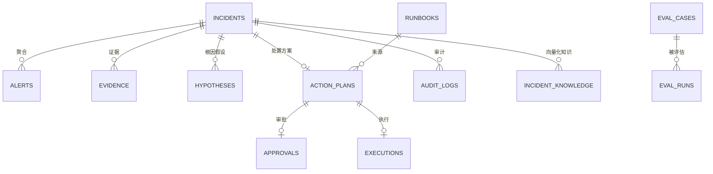
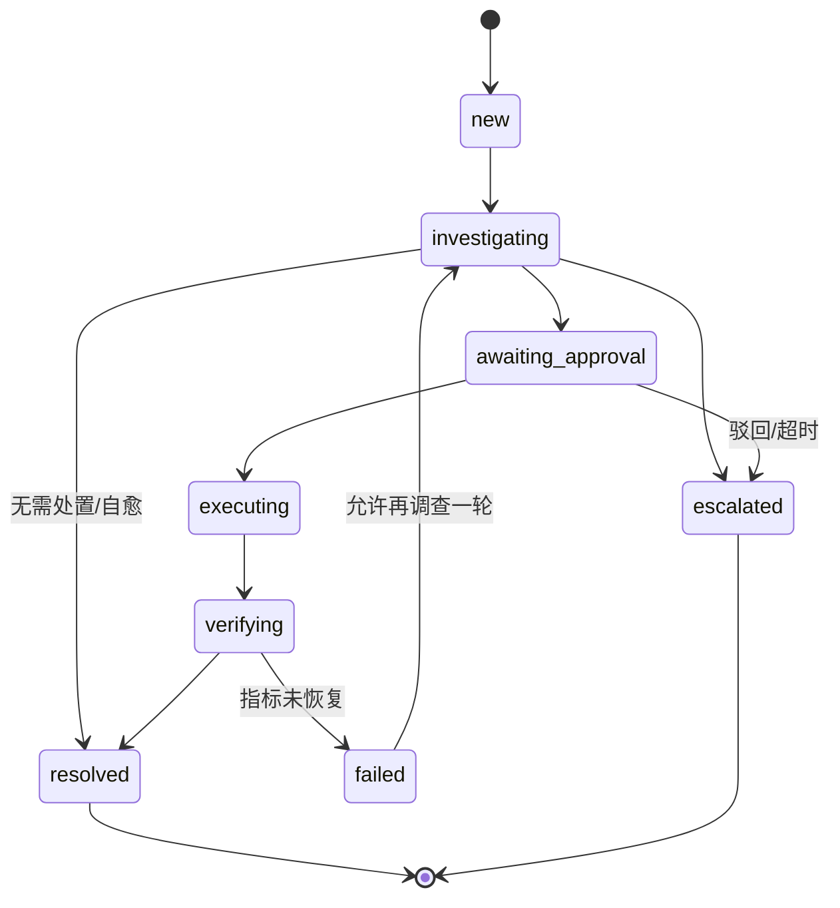

# 02 · 数据库设计

> 目标：**用真实的表结构把 Agent 的每个中间状态落下来。**
> 这不只是为了存数据 —— 面试官问"你的 Agent 怎么调试"，答案是"每个假设、每条证据、每次审批都在表里"。

---

## 1. 选型决策

| 决策 | 选了 | 没选 | 理由（面试直接背） |
|---|---|---|---|
| 主库 | **PostgreSQL 16** | SQLite | incident 是有状态机的多表关联 + 需要并发写 + JSONB 存告警原始载荷。SQLite 写锁会成为 worker 并发的瓶颈。 |
| 向量 | **pgvector** | Chroma | 历史故障检索和业务数据在同一个事务里 —— "找到相似历史故障"和"写入本次诊断结论"可以原子提交。引入 Chroma 就多一个存储、多一次一致性风险，而本例数据量（几千条）远没到需要专用向量库的规模。 |
| 图状态持久化 | **AsyncPostgresSaver** | 内存 / SQLite | HITL 要求进程重启后能 resume，必须落库。SQLite saver 在 worker 多进程下不共享。 |
| 队列 | **Redis + ARQ** | Celery | ARQ 原生 async，和 FastAPI / LangGraph 的 async 链路一致，不用在线程池里跑协程。诊断任务本身就是 async IO 密集。 |
| 字段类型 | **JSONB** | 宽表字段 | 告警 label 是任意 k-v，指标点序列是变长数组。用 JSONB 存 + 对高频查询键建表达式索引。 |

**为什么不用 ORM 的 `create_all` 而用 Alembic**：面试官问"线上怎么改表"，你要能答出"迁移文件版本化、可回滚、和代码版本绑定"。

---

## 2. ER 总览



---

## 3. 状态机

系统有两个独立的状态机，**不要混成一个**：

### 3.1 `incidents.status` —— 故障生命周期



### 3.2 `action_plans.status` —— 单个动作生命周期

```
proposed → awaiting_approval → approved → executing → succeeded
                             ↘ rejected              ↘ failed
```

> **面试点**：为什么分两个状态机？因为一个 incident 可能有多个 action_plan（先重启没效果，再扩容）。incident 是"故障视角"，action_plan 是"动作视角"。

---

## 4. 建表 DDL

> 这是**迁移文件的最终形态**。实际写的时候由 Alembic 生成，但你要先手写一遍理解每张表。

```sql
-- ============ 扩展 ============
CREATE EXTENSION IF NOT EXISTS vector;
CREATE EXTENSION IF NOT EXISTS pg_trgm;   -- 日志/服务名模糊搜索

-- ============ 1. alerts：原始告警（去重后） ============
CREATE TABLE alerts (
    id              BIGSERIAL PRIMARY KEY,
    fingerprint     TEXT        NOT NULL,          -- Alertmanager 的指纹，去重键
    source          TEXT        NOT NULL,          -- alertmanager / manual / api
    name            TEXT        NOT NULL,          -- HighErrorRate
    severity        TEXT        NOT NULL,          -- critical / warning / info
    service         TEXT,                          -- 从 labels 抽出来，便于查询
    labels          JSONB       NOT NULL DEFAULT '{}',
    annotations     JSONB       NOT NULL DEFAULT '{}',
    raw             JSONB       NOT NULL,          -- 原始载荷，排查用
    starts_at       TIMESTAMPTZ NOT NULL,
    ends_at         TIMESTAMPTZ,
    status          TEXT        NOT NULL DEFAULT 'firing',  -- firing / resolved / suppressed
    incident_id     BIGINT      REFERENCES incidents(id) ON DELETE SET NULL,
    created_at      TIMESTAMPTZ NOT NULL DEFAULT now()
);

-- 去重的核心索引：同指纹在 TTL 内只处理一次
CREATE UNIQUE INDEX uq_alerts_fingerprint_firing
    ON alerts (fingerprint) WHERE status = 'firing';
CREATE INDEX idx_alerts_incident  ON alerts (incident_id);
CREATE INDEX idx_alerts_service_t ON alerts (service, starts_at DESC);
CREATE INDEX idx_alerts_labels    ON alerts USING GIN (labels jsonb_path_ops);

-- ============ 2. incidents：聚合后的故障事件 ============
CREATE TABLE incidents (
    id                  BIGSERIAL PRIMARY KEY,
    title               TEXT        NOT NULL,
    service             TEXT,
    severity            TEXT        NOT NULL DEFAULT 'warning',
    status              TEXT        NOT NULL DEFAULT 'new',
    first_alert_at      TIMESTAMPTZ NOT NULL,
    detected_at         TIMESTAMPTZ NOT NULL DEFAULT now(),
    resolved_at         TIMESTAMPTZ,
    mttr_seconds        INTEGER,                    -- resolved_at - first_alert_at
    root_cause          TEXT,                       -- 最终采纳的根因
    confidence          REAL,                       -- 最终置信度 0~1
    summary             TEXT,                       -- 报告正文
    diagnosis_rounds    SMALLINT    NOT NULL DEFAULT 0,
    total_tokens        INTEGER     NOT NULL DEFAULT 0,
    total_cost_usd      NUMERIC(10,6) NOT NULL DEFAULT 0,
    created_at          TIMESTAMPTZ NOT NULL DEFAULT now(),
    updated_at          TIMESTAMPTZ NOT NULL DEFAULT now(),
    CONSTRAINT ck_incidents_status CHECK (status IN (
        'new','investigating','awaiting_approval','executing',
        'verifying','resolved','escalated','failed'
    )),
    CONSTRAINT ck_incidents_confidence CHECK (confidence IS NULL OR (confidence >= 0 AND confidence <= 1))
);

CREATE INDEX idx_incidents_status   ON incidents (status);
CREATE INDEX idx_incidents_service  ON incidents (service, detected_at DESC);
CREATE INDEX idx_incidents_open     ON incidents (detected_at DESC)
    WHERE status NOT IN ('resolved','escalated');

-- ============ 3. evidence：Agent 采集到的每条证据 ============
CREATE TABLE evidence (
    id              BIGSERIAL PRIMARY KEY,
    incident_id     BIGINT      NOT NULL REFERENCES incidents(id) ON DELETE CASCADE,
    round           SMALLINT    NOT NULL DEFAULT 1,   -- 第几轮调查
    kind            TEXT        NOT NULL,             -- logs / metrics / changes / topology / history
    tool_name       TEXT        NOT NULL,             -- MCP 工具名，可追溯
    request         JSONB       NOT NULL DEFAULT '{}',-- 调用入参
    payload         JSONB       NOT NULL,             -- 原始返回（已截断）
    summary         TEXT,                             -- 给 LLM 看的摘要
    duration_ms     INTEGER,
    ok              BOOLEAN     NOT NULL DEFAULT true,
    error           TEXT,
    collected_at    TIMESTAMPTZ NOT NULL DEFAULT now()
);

CREATE INDEX idx_evidence_incident ON evidence (incident_id, round, kind);

-- ============ 4. hypotheses：根因假设（排序后） ============
CREATE TABLE hypotheses (
    id                      BIGSERIAL PRIMARY KEY,
    incident_id             BIGINT   NOT NULL REFERENCES incidents(id) ON DELETE CASCADE,
    round                   SMALLINT NOT NULL DEFAULT 1,
    rank                    SMALLINT NOT NULL,        -- 1 = 最可能
    statement               TEXT     NOT NULL,        -- "redis 连接池耗尽导致 api 超时"
    confidence              REAL     NOT NULL,
    rationale               TEXT,                     -- 判断依据
    supporting_evidence_ids JSONB    NOT NULL DEFAULT '[]',
    adopted                 BOOLEAN  NOT NULL DEFAULT false,
    created_at              TIMESTAMPTZ NOT NULL DEFAULT now(),
    CONSTRAINT uq_hypotheses_rank UNIQUE (incident_id, round, rank)
);

CREATE INDEX idx_hypotheses_incident ON hypotheses (incident_id, round);

-- ============ 5. runbooks：处置手册（决定 Agent 能做什么） ============
CREATE TABLE runbooks (
    id          BIGSERIAL PRIMARY KEY,
    code        TEXT        NOT NULL UNIQUE,   -- restart_high_memory
    title       TEXT        NOT NULL,
    service     TEXT,                          -- NULL = 通用
    match_rule  JSONB       NOT NULL DEFAULT '{}',  -- 匹配条件：{"root_cause_tags":["memory_leak"]}
    action      TEXT        NOT NULL,          -- 对应 executor 的动作名
    params_tpl  JSONB       NOT NULL DEFAULT '{}',  -- 参数模板，含 {{service}} 占位
    risk_level  TEXT        NOT NULL,          -- LOW / MEDIUM / HIGH / CRITICAL
    requires_approval BOOLEAN NOT NULL DEFAULT true,
    steps       JSONB       NOT NULL DEFAULT '[]',  -- 人类可读步骤
    is_active   BOOLEAN     NOT NULL DEFAULT true,
    created_at  TIMESTAMPTZ NOT NULL DEFAULT now(),
    CONSTRAINT ck_runbooks_risk CHECK (risk_level IN ('LOW','MEDIUM','HIGH','CRITICAL'))
);

CREATE INDEX idx_runbooks_match ON runbooks (service, is_active);

-- ============ 6. action_plans：处置方案 ============
CREATE TABLE action_plans (
    id            BIGSERIAL PRIMARY KEY,
    incident_id   BIGINT      NOT NULL REFERENCES incidents(id) ON DELETE CASCADE,
    runbook_id    BIGINT      REFERENCES runbooks(id),
    action        TEXT        NOT NULL,
    target        TEXT        NOT NULL,
    params        JSONB       NOT NULL DEFAULT '{}',
    risk_level    TEXT        NOT NULL,
    reason        TEXT,                        -- 为什么选这个方案（LLM 生成）
    status        TEXT        NOT NULL DEFAULT 'proposed',
    created_at    TIMESTAMPTZ NOT NULL DEFAULT now(),
    CONSTRAINT ck_plans_status CHECK (status IN (
        'proposed','awaiting_approval','approved','rejected','executing','succeeded','failed'
    ))
);

CREATE INDEX idx_plans_incident ON action_plans (incident_id, created_at DESC);
CREATE INDEX idx_plans_pending  ON action_plans (status) WHERE status = 'awaiting_approval';

-- ============ 7. approvals：审批记录 ============
CREATE TABLE approvals (
    id             BIGSERIAL PRIMARY KEY,
    action_plan_id BIGINT      NOT NULL REFERENCES action_plans(id) ON DELETE CASCADE,
    thread_id      TEXT        NOT NULL,      -- LangGraph thread_id，resume 用
    requested_at   TIMESTAMPTZ NOT NULL DEFAULT now(),
    decided_at     TIMESTAMPTZ,
    decision       TEXT,                      -- approved / rejected / timeout
    approver       TEXT,
    comment        TEXT,
    -- 审批人当时看到的上下文快照，事后复盘用
    context_snapshot JSONB     NOT NULL DEFAULT '{}',
    CONSTRAINT ck_approvals_decision CHECK (
        decision IS NULL OR decision IN ('approved','rejected','timeout')
    )
);

CREATE INDEX idx_approvals_pending ON approvals (requested_at DESC) WHERE decision IS NULL;
CREATE UNIQUE INDEX uq_approvals_plan ON approvals (action_plan_id);

-- ============ 8. executions：执行记录（幂等键在这） ============
CREATE TABLE executions (
    id                BIGSERIAL PRIMARY KEY,
    action_plan_id    BIGINT      NOT NULL REFERENCES action_plans(id) ON DELETE CASCADE,
    idempotency_key   TEXT        NOT NULL UNIQUE,   -- 幂等的全部秘密
    action            TEXT        NOT NULL,
    target            TEXT        NOT NULL,
    params            JSONB       NOT NULL DEFAULT '{}',
    status            TEXT        NOT NULL DEFAULT 'running',
    result            JSONB,
    error             TEXT,
    started_at        TIMESTAMPTZ NOT NULL DEFAULT now(),
    finished_at       TIMESTAMPTZ,
    duration_ms       INTEGER,
    CONSTRAINT ck_exec_status CHECK (status IN ('running','succeeded','failed','skipped'))
);

CREATE INDEX idx_exec_plan ON executions (action_plan_id);

-- ============ 9. audit_logs：审计（AI 操作系统必须有） ============
CREATE TABLE audit_logs (
    id           BIGSERIAL PRIMARY KEY,
    incident_id  BIGINT      REFERENCES incidents(id) ON DELETE SET NULL,
    actor        TEXT        NOT NULL,        -- agent / user:alice / system
    actor_type   TEXT        NOT NULL,        -- agent / human / system
    action       TEXT        NOT NULL,        -- approve / reject / execute / escalate
    target_type  TEXT,
    target_id    TEXT,
    detail       JSONB       NOT NULL DEFAULT '{}',
    ip           INET,
    created_at   TIMESTAMPTZ NOT NULL DEFAULT now()
);

CREATE INDEX idx_audit_incident ON audit_logs (incident_id, created_at DESC);
CREATE INDEX idx_audit_actor    ON audit_logs (actor, created_at DESC);

-- ============ 10. incident_knowledge：向量化历史故障 ============
CREATE TABLE incident_knowledge (
    id           BIGSERIAL PRIMARY KEY,
    incident_id  BIGINT      REFERENCES incidents(id) ON DELETE SET NULL,
    kind         TEXT        NOT NULL DEFAULT 'incident',  -- incident / runbook / doc
    title        TEXT        NOT NULL,
    content      TEXT        NOT NULL,
    -- 维度必须和 embedding 模型一致；bge-small-zh 是 512，bge-m3 是 1024
    embedding    vector(1024),
    metadata     JSONB       NOT NULL DEFAULT '{}',
    created_at   TIMESTAMPTZ NOT NULL DEFAULT now()
);

-- HNSW 索引：查询快，构建慢，适合读多写少
CREATE INDEX idx_knowledge_embedding ON incident_knowledge
    USING hnsw (embedding vector_cosine_ops) WITH (m = 16, ef_construction = 64);
CREATE INDEX idx_knowledge_kind ON incident_knowledge (kind);

-- ============ 11. eval_cases / eval_runs：评估体系 ============
CREATE TABLE eval_cases (
    id                   BIGSERIAL PRIMARY KEY,
    name                 TEXT NOT NULL UNIQUE,
    alert_payload        JSONB NOT NULL,       -- 回放用的告警
    expected_service     TEXT,
    expected_root_cause  TEXT NOT NULL,
    expected_tags        JSONB NOT NULL DEFAULT '[]',  -- 根因标签，模糊匹配用
    expected_action      TEXT,                 -- 期望的动作（可空）
    difficulty           TEXT NOT NULL DEFAULT 'normal',
    notes                TEXT,
    created_at           TIMESTAMPTZ NOT NULL DEFAULT now()
);

CREATE TABLE eval_runs (
    id              BIGSERIAL PRIMARY KEY,
    started_at      TIMESTAMPTZ NOT NULL DEFAULT now(),
    finished_at     TIMESTAMPTZ,
    git_sha         TEXT,
    model           TEXT,
    prompt_version  TEXT,
    total           INTEGER NOT NULL DEFAULT 0,
    service_correct INTEGER NOT NULL DEFAULT 0,
    root_cause_correct INTEGER NOT NULL DEFAULT 0,
    action_correct  INTEGER NOT NULL DEFAULT 0,
    avg_latency_ms  INTEGER,
    avg_prompt_tokens     INTEGER,
    avg_completion_tokens INTEGER,
    total_cost_usd  NUMERIC(10,6),
    detail          JSONB NOT NULL DEFAULT '[]',
    CONSTRAINT uq_eval_runs_sha UNIQUE (git_sha, model, prompt_version)
);

CREATE INDEX idx_eval_runs_time ON eval_runs (started_at DESC);
```

---

## 5. LangGraph checkpointer 表

**不要手写这三张表。** `AsyncPostgresSaver.setup()` 会自动建：

```python
async with AsyncPostgresSaver.from_conn_string(PG_DSN) as saver:
    await saver.setup()      # 建 checkpoints / checkpoint_blobs / checkpoint_writes
```

| 表 | 作用 |
|---|---|
| `checkpoints` | 每个 thread 每个 step 的图状态快照（含 `channel_values`，就是你的 IncidentState） |
| `checkpoint_blobs` | 大对象单独存（`channel_versions` 引用的二进制/JSON） |
| `checkpoint_writes` | 同一 step 内的中间写入（并行分支各写各的，靠它合并） |

**为什么不能把 checkpointer 表和业务表混在一起**：`channel_values` 是 LangGraph 的内部编码，结构随版本变。业务表要稳定，框架内部表跟着框架走。**但可以同库不同 schema**：

```sql
CREATE SCHEMA IF NOT EXISTS langgraph;
```
在 DSN 里用 `?options=-csearch_path%3Dlanggraph` 或 `AsyncPostgresSaver(..., )` 的 schema 参数指定，避免和业务表混在一起。

**面试题**：「checkpointer 和 store 有什么区别？」
- **checkpointer** = 图的**内部状态**，按 `thread_id` 存，用于 resume 和 time travel。是"我在哪"。
- **store** = 跨 thread 的**长期记忆**，按 namespace/key 存，用于"我记得什么"。你这个项目的 `incident_knowledge` 表其实就是自己实现的 store。**能答出"我为什么自己建表而不用 LangGraph Store"**：因为要用 pgvector 做相似度检索，Store 的检索能力不够。

---

## 6. SQLAlchemy 2.0 模型

```python
# app/db/models.py
from datetime import datetime
from decimal import Decimal

from pgvector.sqlalchemy import Vector
from sqlalchemy import (
    BigInteger, Boolean, CheckConstraint, DateTime, ForeignKey, Index,
    Integer, Numeric, REAL, SmallInteger, String, Text, UniqueConstraint, func,
)
from sqlalchemy.dialects.postgresql import INET, JSONB
from sqlalchemy.orm import DeclarativeBase, Mapped, mapped_column, relationship


class Base(DeclarativeBase):
    pass


class Incident(Base):
    __tablename__ = "incidents"

    id: Mapped[int] = mapped_column(BigInteger, primary_key=True)
    title: Mapped[str] = mapped_column(Text, nullable=False)
    service: Mapped[str | None] = mapped_column(Text)
    severity: Mapped[str] = mapped_column(Text, nullable=False, default="warning")
    status: Mapped[str] = mapped_column(Text, nullable=False, default="new")
    first_alert_at: Mapped[datetime] = mapped_column(DateTime(timezone=True), nullable=False)
    detected_at: Mapped[datetime] = mapped_column(
        DateTime(timezone=True), nullable=False, server_default=func.now()
    )
    resolved_at: Mapped[datetime | None] = mapped_column(DateTime(timezone=True))
    mttr_seconds: Mapped[int | None] = mapped_column(Integer)
    root_cause: Mapped[str | None] = mapped_column(Text)
    confidence: Mapped[float | None] = mapped_column(REAL)
    summary: Mapped[str | None] = mapped_column(Text)
    diagnosis_rounds: Mapped[int] = mapped_column(SmallInteger, nullable=False, default=0)
    total_tokens: Mapped[int] = mapped_column(Integer, nullable=False, default=0)
    total_cost_usd: Mapped[Decimal] = mapped_column(
        Numeric(10, 6), nullable=False, default=Decimal("0")
    )
    created_at: Mapped[datetime] = mapped_column(
        DateTime(timezone=True), nullable=False, server_default=func.now()
    )
    updated_at: Mapped[datetime] = mapped_column(
        DateTime(timezone=True), nullable=False, server_default=func.now(), onupdate=func.now()
    )

    alerts: Mapped[list["Alert"]] = relationship(back_populates="incident")
    evidence: Mapped[list["Evidence"]] = relationship(back_populates="incident")

    __table_args__ = (
        CheckConstraint(
            "status IN ('new','investigating','awaiting_approval','executing',"
            "'verifying','resolved','escalated','failed')",
            name="ck_incidents_status",
        ),
        Index("idx_incidents_status", "status"),
        Index("idx_incidents_service", "service", detected_at.desc()),
    )


class Alert(Base):
    __tablename__ = "alerts"

    id: Mapped[int] = mapped_column(BigInteger, primary_key=True)
    fingerprint: Mapped[str] = mapped_column(Text, nullable=False)
    source: Mapped[str] = mapped_column(Text, nullable=False, default="alertmanager")
    name: Mapped[str] = mapped_column(Text, nullable=False)
    severity: Mapped[str] = mapped_column(Text, nullable=False)
    service: Mapped[str | None] = mapped_column(Text)
    labels: Mapped[dict] = mapped_column(JSONB, nullable=False, default=dict)
    annotations: Mapped[dict] = mapped_column(JSONB, nullable=False, default=dict)
    raw: Mapped[dict] = mapped_column(JSONB, nullable=False)
    starts_at: Mapped[datetime] = mapped_column(DateTime(timezone=True), nullable=False)
    ends_at: Mapped[datetime | None] = mapped_column(DateTime(timezone=True))
    status: Mapped[str] = mapped_column(Text, nullable=False, default="firing")
    incident_id: Mapped[int | None] = mapped_column(
        ForeignKey("incidents.id", ondelete="SET NULL")
    )
    created_at: Mapped[datetime] = mapped_column(
        DateTime(timezone=True), nullable=False, server_default=func.now()
    )

    incident: Mapped[Incident | None] = relationship(back_populates="alerts")


class Evidence(Base):
    __tablename__ = "evidence"

    id: Mapped[int] = mapped_column(BigInteger, primary_key=True)
    incident_id: Mapped[int] = mapped_column(
        ForeignKey("incidents.id", ondelete="CASCADE"), nullable=False
    )
    round: Mapped[int] = mapped_column(SmallInteger, nullable=False, default=1)
    kind: Mapped[str] = mapped_column(Text, nullable=False)
    tool_name: Mapped[str] = mapped_column(Text, nullable=False)
    request: Mapped[dict] = mapped_column(JSONB, nullable=False, default=dict)
    payload: Mapped[dict] = mapped_column(JSONB, nullable=False)
    summary: Mapped[str | None] = mapped_column(Text)
    duration_ms: Mapped[int | None] = mapped_column(Integer)
    ok: Mapped[bool] = mapped_column(Boolean, nullable=False, default=True)
    error: Mapped[str | None] = mapped_column(Text)
    collected_at: Mapped[datetime] = mapped_column(
        DateTime(timezone=True), nullable=False, server_default=func.now()
    )

    incident: Mapped[Incident] = relationship(back_populates="evidence")


class Hypothesis(Base):
    __tablename__ = "hypotheses"

    id: Mapped[int] = mapped_column(BigInteger, primary_key=True)
    incident_id: Mapped[int] = mapped_column(
        ForeignKey("incidents.id", ondelete="CASCADE"), nullable=False
    )
    round: Mapped[int] = mapped_column(SmallInteger, nullable=False, default=1)
    rank: Mapped[int] = mapped_column(SmallInteger, nullable=False)
    statement: Mapped[str] = mapped_column(Text, nullable=False)
    confidence: Mapped[float] = mapped_column(REAL, nullable=False)
    rationale: Mapped[str | None] = mapped_column(Text)
    supporting_evidence_ids: Mapped[list] = mapped_column(JSONB, nullable=False, default=list)
    adopted: Mapped[bool] = mapped_column(Boolean, nullable=False, default=False)
    created_at: Mapped[datetime] = mapped_column(
        DateTime(timezone=True), nullable=False, server_default=func.now()
    )

    __table_args__ = (
        UniqueConstraint("incident_id", "round", "rank", name="uq_hypotheses_rank"),
    )


class Runbook(Base):
    __tablename__ = "runbooks"

    id: Mapped[int] = mapped_column(BigInteger, primary_key=True)
    code: Mapped[str] = mapped_column(Text, nullable=False, unique=True)
    title: Mapped[str] = mapped_column(Text, nullable=False)
    service: Mapped[str | None] = mapped_column(Text)
    match_rule: Mapped[dict] = mapped_column(JSONB, nullable=False, default=dict)
    action: Mapped[str] = mapped_column(Text, nullable=False)
    params_tpl: Mapped[dict] = mapped_column(JSONB, nullable=False, default=dict)
    risk_level: Mapped[str] = mapped_column(Text, nullable=False)
    requires_approval: Mapped[bool] = mapped_column(Boolean, nullable=False, default=True)
    steps: Mapped[list] = mapped_column(JSONB, nullable=False, default=list)
    is_active: Mapped[bool] = mapped_column(Boolean, nullable=False, default=True)
    created_at: Mapped[datetime] = mapped_column(
        DateTime(timezone=True), nullable=False, server_default=func.now()
    )


class ActionPlan(Base):
    __tablename__ = "action_plans"

    id: Mapped[int] = mapped_column(BigInteger, primary_key=True)
    incident_id: Mapped[int] = mapped_column(
        ForeignKey("incidents.id", ondelete="CASCADE"), nullable=False
    )
    runbook_id: Mapped[int | None] = mapped_column(ForeignKey("runbooks.id"))
    action: Mapped[str] = mapped_column(Text, nullable=False)
    target: Mapped[str] = mapped_column(Text, nullable=False)
    params: Mapped[dict] = mapped_column(JSONB, nullable=False, default=dict)
    risk_level: Mapped[str] = mapped_column(Text, nullable=False)
    reason: Mapped[str | None] = mapped_column(Text)
    status: Mapped[str] = mapped_column(Text, nullable=False, default="proposed")
    created_at: Mapped[datetime] = mapped_column(
        DateTime(timezone=True), nullable=False, server_default=func.now()
    )


class Approval(Base):
    __tablename__ = "approvals"

    id: Mapped[int] = mapped_column(BigInteger, primary_key=True)
    action_plan_id: Mapped[int] = mapped_column(
        ForeignKey("action_plans.id", ondelete="CASCADE"), nullable=False, unique=True
    )
    thread_id: Mapped[str] = mapped_column(Text, nullable=False)
    requested_at: Mapped[datetime] = mapped_column(
        DateTime(timezone=True), nullable=False, server_default=func.now()
    )
    decided_at: Mapped[datetime | None] = mapped_column(DateTime(timezone=True))
    decision: Mapped[str | None] = mapped_column(Text)
    approver: Mapped[str | None] = mapped_column(Text)
    comment: Mapped[str | None] = mapped_column(Text)
    context_snapshot: Mapped[dict] = mapped_column(JSONB, nullable=False, default=dict)


class Execution(Base):
    __tablename__ = "executions"

    id: Mapped[int] = mapped_column(BigInteger, primary_key=True)
    action_plan_id: Mapped[int] = mapped_column(
        ForeignKey("action_plans.id", ondelete="CASCADE"), nullable=False
    )
    idempotency_key: Mapped[str] = mapped_column(Text, nullable=False, unique=True)
    action: Mapped[str] = mapped_column(Text, nullable=False)
    target: Mapped[str] = mapped_column(Text, nullable=False)
    params: Mapped[dict] = mapped_column(JSONB, nullable=False, default=dict)
    status: Mapped[str] = mapped_column(Text, nullable=False, default="running")
    result: Mapped[dict | None] = mapped_column(JSONB)
    error: Mapped[str | None] = mapped_column(Text)
    started_at: Mapped[datetime] = mapped_column(
        DateTime(timezone=True), nullable=False, server_default=func.now()
    )
    finished_at: Mapped[datetime | None] = mapped_column(DateTime(timezone=True))
    duration_ms: Mapped[int | None] = mapped_column(Integer)


class AuditLog(Base):
    __tablename__ = "audit_logs"

    id: Mapped[int] = mapped_column(BigInteger, primary_key=True)
    incident_id: Mapped[int | None] = mapped_column(
        ForeignKey("incidents.id", ondelete="SET NULL")
    )
    actor: Mapped[str] = mapped_column(Text, nullable=False)
    actor_type: Mapped[str] = mapped_column(Text, nullable=False)
    action: Mapped[str] = mapped_column(Text, nullable=False)
    target_type: Mapped[str | None] = mapped_column(Text)
    target_id: Mapped[str | None] = mapped_column(Text)
    detail: Mapped[dict] = mapped_column(JSONB, nullable=False, default=dict)
    ip: Mapped[str | None] = mapped_column(INET)
    created_at: Mapped[datetime] = mapped_column(
        DateTime(timezone=True), nullable=False, server_default=func.now()
    )


class IncidentKnowledge(Base):
    __tablename__ = "incident_knowledge"

    id: Mapped[int] = mapped_column(BigInteger, primary_key=True)
    incident_id: Mapped[int | None] = mapped_column(ForeignKey("incidents.id", ondelete="SET NULL"))
    kind: Mapped[str] = mapped_column(Text, nullable=False, default="incident")
    title: Mapped[str] = mapped_column(Text, nullable=False)
    content: Mapped[str] = mapped_column(Text, nullable=False)
    # 维度写死 1024，换 embedding 模型必须同时改这里 + 迁移文件
    embedding: Mapped[list[float] | None] = mapped_column(Vector(1024))
    metadata_: Mapped[dict] = mapped_column("metadata", JSONB, nullable=False, default=dict)
    created_at: Mapped[datetime] = mapped_column(
        DateTime(timezone=True), nullable=False, server_default=func.now()
    )
```

---

## 7. 会话与事务

```python
# app/db/base.py
from collections.abc import AsyncIterator
from contextlib import asynccontextmanager

from sqlalchemy.ext.asyncio import AsyncSession, async_sessionmaker, create_async_engine

from app.config import settings

engine = create_async_engine(
    settings.pg_dsn,                    # postgresql+asyncpg://user:pw@postgres:5432/oncall
    echo=False,
    pool_size=10,                       # 常驻连接
    max_overflow=20,                    # 峰值可临时扩到 30
    pool_pre_ping=True,                 # 取连接前 ping，防"连接已被服务端断开"
    pool_recycle=1800,                  # 30 分钟回收，防云上空闲断连
)

SessionLocal = async_sessionmaker(
    engine, class_=AsyncSession, expire_on_commit=False, autoflush=False
)


async def get_session() -> AsyncIterator[AsyncSession]:
    """FastAPI 依赖注入用"""
    async with SessionLocal() as session:
        yield session


@asynccontextmanager
async def session_scope() -> AsyncIterator[AsyncSession]:
    """worker / 脚本里手动开事务用"""
    async with SessionLocal() as session:
        try:
            yield session
            await session.commit()
        except Exception:
            await session.rollback()
            raise
```

**逐句说明两个关键参数**：

- `expire_on_commit=False` —— 提交后对象属性不失效。默认 `True` 时 commit 后再访问 `incident.id` 会触发一次新查询，在 async 上下文里会报 `MissingGreenlet` 错误。这是 async SQLAlchemy 最经典的坑。
- `pool_pre_ping=True` —— 从池里取连接时先发一个轻量探测。Postgres 或中间网络会静默掐掉空闲连接，不 ping 的话会拿到死连接报错。

---

## 8. 关键查询示例

### 8.1 幂等执行（整个项目最重要的 SQL）

```python
# app/db/repo.py
from sqlalchemy import select
from sqlalchemy.exc import IntegrityError


async def claim_execution(
    session: AsyncSession, *, plan_id: int, action: str, target: str,
    params: dict, idempotency_key: str,
) -> tuple[Execution, bool]:
    """尝试占用幂等键。

    返回 (execution, is_new)：
      is_new=True  → 本次是首次执行，调用方应该真的执行动作
      is_new=False → 已经执行过，直接返回历史结果，不重复执行
    """
    existing = await session.scalar(
        select(Execution).where(Execution.idempotency_key == idempotency_key)
    )
    if existing is not None:
        return existing, False

    row = Execution(
        action_plan_id=plan_id, idempotency_key=idempotency_key,
        action=action, target=target, params=params, status="running",
    )
    session.add(row)
    try:
        await session.flush()          # 立刻触发 INSERT，让唯一索引生效
    except IntegrityError:
        # 并发下另一个 worker 抢先插入了 —— 这就是唯一索引兜底的价值
        await session.rollback()
        existing = await session.scalar(
            select(Execution).where(Execution.idempotency_key == idempotency_key)
        )
        return existing, False
    return row, True
```

**为什么用"先查再插"而不是"依赖唯一索引"**：两个都要。
- 先查：正常路径少一次异常，快。
- 唯一索引：并发竞态下兜底，**唯一索引是正确性保证，先查是性能优化**。这是面试高频问题"你怎么保证幂等"，答出这层才是真懂。

### 8.2 找相似历史故障（pgvector）

```python
async def find_similar_incidents(
    session: AsyncSession, embedding: list[float], *, limit: int = 3, min_score: float = 0.75
) -> list[tuple[IncidentKnowledge, float]]:
    """余弦相似度检索。

    注意 <=> 是 pgvector 的余弦距离运算符（0 = 完全相同），
    所以 相似度 = 1 - 距离。
    """
    distance = IncidentKnowledge.embedding.cosine_distance(embedding).label("distance")
    stmt = (
        select(IncidentKnowledge, distance)
        .where(IncidentKnowledge.embedding.is_not(None))
        .where(IncidentKnowledge.kind == "incident")
        .order_by(distance)
        .limit(limit)
    )
    rows = (await session.execute(stmt)).all()
    return [(kb, 1.0 - float(d)) for kb, d in rows if 1.0 - float(d) >= min_score]
```

**索引选择**：`hnsw` vs `ivfflat`
- HNSW：查询快、召回高、构建慢、内存占用大。**读多写少选它** —— 本项目历史故障写入频率低，选 HNSW。
- IVFFlat：构建快、需要先有数据再建索引（要训练聚类中心）。
- 数据量 < 1 万条时，**不建索引全表扫也够快**，可以先不建，等项目后期再补。这一点要在 README 里写清楚，是加分项。

---

## 9. 迁移与种子数据

```bash
# 初始化（异步模板）
alembic init -t async alembic

# 生成迁移 —— 一定要 review 生成的 DDL，尤其是 vector 和 JSONB
alembic revision --autogenerate -m "init schema"

# 应用
alembic upgrade head
alembic downgrade -1        # 演练回滚，面试会问"迁移出问题怎么办"
```

`alembic/env.py` 里必须加的两句（**不加 autogenerate 会生成空迁移**）：

```python
from app.db.models import Base           # noqa: F401  必须 import，否则 Base.metadata 是空的
target_metadata = Base.metadata
```

`vector` 扩展要在迁移里显式创建，Alembic 不会自动生成：

```python
def upgrade() -> None:
    op.execute("CREATE EXTENSION IF NOT EXISTS vector")
    op.execute("CREATE EXTENSION IF NOT EXISTS pg_trgm")
    # ... 其余建表
```

### 种子数据：runbooks

这是**项目的策略层**，决定 Agent 的能力边界。第一版手写 6 条就够：

| code | service | 触发条件 | action | risk |
|---|---|---|---|---|
| `restart_high_memory` | `*` | root_cause_tags 含 `memory_leak` | `restart_deployment` | MEDIUM |
| `scale_out_cpu` | `*` | tags 含 `cpu_saturation` | `scale_deployment` | MEDIUM |
| `rollback_bad_deploy` | `*` | tags 含 `bad_release` | `rollback_deployment` | HIGH |
| `restart_deadlock` | `*` | tags 含 `db_deadlock` | `restart_deployment` | MEDIUM |
| `clear_cache_pressure` | `*` | tags 含 `cache_miss_storm` | `restart_deployment` | LOW |
| `escalate_unknown` | `*` | 兜底 | — | CRITICAL |

```sql
INSERT INTO runbooks (code, title, service, match_rule, action, params_tpl, risk_level, requires_approval, steps)
VALUES
('restart_high_memory', '内存泄漏重启', NULL,
 '{"root_cause_tags": ["memory_leak"]}',
 'restart_deployment', '{"service": "{{service}}", "grace_period": 30}',
 'MEDIUM', true, '["确认内存曲线持续上升","滚动重启","观察 5 分钟内存回落"]'),
('rollback_bad_deploy', '发版回滚', NULL,
 '{"root_cause_tags": ["bad_release"]}',
 'rollback_deployment', '{"service": "{{service}}", "to_revision": "{{prev_revision}}"}',
 'HIGH', true, '["确认最近一次发版与异常时间吻合","先 dry_run","回滚到上一版本","验证错误率"]');
```

> **面试点**：`match_rule` 用 JSONB 而不是硬编码 if-else，是为了让「Agent 能做什么」变成**数据**而不是**代码**。加一个处置场景不用改代码、不用重新发版。这是"策略与执行分离"。

---

## 10. 本文档对应的验收清单

- [ ] `alembic upgrade head` 一次成功，11 张业务表 + 3 张 checkpointer 表都在
- [ ] `alembic downgrade -1 && alembic upgrade head` 能来回跑通（证明迁移可回滚）
- [ ] 用 `\d+ executions` 确认 `idempotency_key` 上有唯一索引
- [ ] 用 `\d+ incident_knowledge` 确认 `embedding` 是 `vector(1024)`
- [ ] 手写 SQL 插一条 incident + alert，验证外键和 CHECK 约束真的会拦非法状态
- [ ] 种子 runbooks 6 条插入成功，`risk_level` 都在允许枚举内
- [ ] 能解释：为什么 `evidence` 表的 `payload` 存截断后的数据（防单行过 TB / 防 LLM 上下文爆）

---

## 下一步

表建好了，开始写代码 → `03-代码指导-基础层.md`
